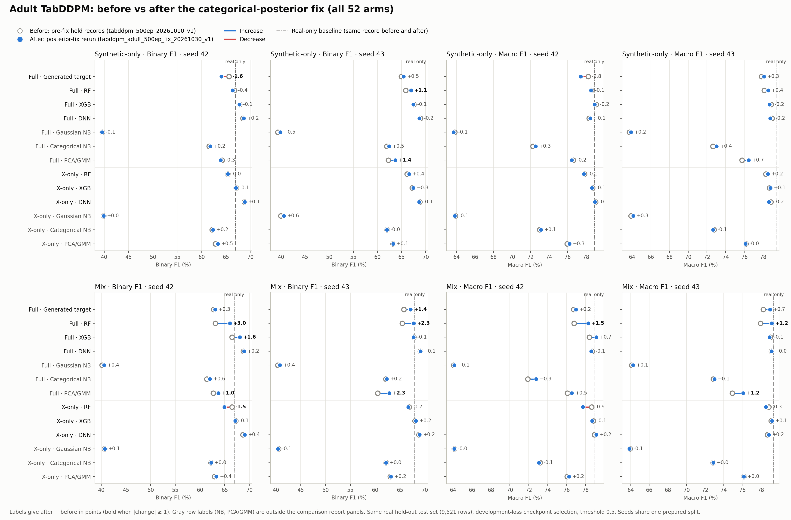

# Adult TabDDPM before vs after the posterior fix

All 52 arms: seeds 42/43, synthetic-only and mix. Scores are percentages on the same Adult held-out test set. Before = held pre-fix records (`tabddpm_500ep_20261010_v1`); after = posterior-fix rerun (`tabddpm_adult_500ep_fix_20261030_v1`). Real-only baselines are the same records in both. Rows marked * are in the comparison report panels.

## Synthetic-only

| Arm | Seed | Binary F1 before | after | Δ | Macro F1 before | after | Δ | Accuracy before | after | Δ |
|---|---:|---:|---:|---:|---:|---:|---:|---:|---:|---:|
| Full · Generated target * | 42 | 65.64 | 64.07 | -1.56 | 78.22 | 77.44 | -0.78 | 85.48 | 85.35 | -0.14 |
| Full · Generated target * | 43 | 64.95 | 65.44 | +0.49 | 77.82 | 78.09 | +0.27 | 85.29 | 85.40 | +0.12 |
| Full · RF * | 42 | 66.78 | 66.41 | -0.37 | 78.58 | 78.52 | -0.06 | 85.10 | 85.36 | +0.26 |
| Full · RF * | 43 | 65.86 | 66.96 | +1.10 | 78.11 | 78.53 | +0.42 | 84.97 | 84.78 | -0.19 |
| Full · XGB * | 42 | 67.84 | 67.76 | -0.08 | 79.10 | 78.94 | -0.16 | 85.18 | 84.89 | -0.29 |
| Full · XGB * | 43 | 67.54 | 67.43 | -0.11 | 78.85 | 78.70 | -0.15 | 84.91 | 84.67 | -0.24 |
| Full · DNN * | 42 | 68.49 | 68.67 | +0.18 | 78.33 | 78.47 | +0.14 | 82.80 | 82.92 | +0.13 |
| Full · DNN * | 43 | 68.93 | 68.68 | -0.25 | 78.96 | 78.76 | -0.20 | 83.74 | 83.55 | -0.19 |
| Full · Gaussian NB | 42 | 39.61 | 39.55 | -0.06 | 63.82 | 63.69 | -0.13 | 80.01 | 79.74 | -0.27 |
| Full · Gaussian NB | 43 | 39.35 | 39.85 | +0.50 | 63.71 | 63.88 | +0.17 | 80.05 | 79.87 | -0.19 |
| Full · Categorical NB | 42 | 61.56 | 61.76 | +0.20 | 72.26 | 72.55 | +0.30 | 76.38 | 76.80 | +0.42 |
| Full · Categorical NB | 43 | 61.93 | 62.40 | +0.47 | 72.64 | 73.04 | +0.40 | 76.83 | 77.24 | +0.41 |
| Full · PCA/GMM | 42 | 64.22 | 63.91 | -0.30 | 76.63 | 76.45 | -0.18 | 83.23 | 83.12 | -0.10 |
| Full · PCA/GMM | 43 | 62.25 | 63.68 | +1.44 | 75.74 | 76.46 | +0.71 | 83.26 | 83.38 | +0.13 |
| X-only · RF * | 42 | 65.37 | 65.37 | -0.00 | 77.83 | 77.77 | -0.06 | 84.83 | 84.69 | -0.15 |
| X-only · RF * | 43 | 66.14 | 66.56 | +0.41 | 78.30 | 78.51 | +0.21 | 85.11 | 85.16 | +0.05 |
| X-only · XGB * | 42 | 67.11 | 67.05 | -0.06 | 78.71 | 78.62 | -0.09 | 85.02 | 84.89 | -0.14 |
| X-only · XGB * | 43 | 67.18 | 67.44 | +0.25 | 78.68 | 78.79 | +0.11 | 84.89 | 84.86 | -0.02 |
| X-only · DNN * | 42 | 68.80 | 68.86 | +0.07 | 79.02 | 78.96 | -0.06 | 84.00 | 83.81 | -0.19 |
| X-only · DNN * | 43 | 68.78 | 68.64 | -0.15 | 78.83 | 78.62 | -0.21 | 83.59 | 83.28 | -0.32 |
| X-only · Gaussian NB | 42 | 39.86 | 39.86 | +0.00 | 63.88 | 63.81 | -0.07 | 79.84 | 79.66 | -0.19 |
| X-only · Gaussian NB | 43 | 39.96 | 40.58 | +0.61 | 63.88 | 64.13 | +0.26 | 79.71 | 79.60 | -0.10 |
| X-only · Categorical NB | 42 | 62.14 | 62.37 | +0.23 | 72.98 | 73.13 | +0.14 | 77.33 | 77.43 | +0.09 |
| X-only · Categorical NB | 43 | 61.98 | 61.96 | -0.02 | 72.75 | 72.67 | -0.08 | 77.00 | 76.86 | -0.14 |
| X-only · PCA/GMM | 42 | 62.81 | 63.33 | +0.52 | 75.95 | 76.20 | +0.25 | 83.12 | 83.16 | +0.04 |
| X-only · PCA/GMM | 43 | 63.21 | 63.27 | +0.06 | 76.17 | 76.12 | -0.05 | 83.22 | 83.04 | -0.18 |

## Mix

| Arm | Seed | Binary F1 before | after | Δ | Macro F1 before | after | Δ | Accuracy before | after | Δ |
|---|---:|---:|---:|---:|---:|---:|---:|---:|---:|---:|
| Full · Generated target * | 42 | 62.74 | 63.07 | +0.33 | 76.75 | 76.99 | +0.24 | 85.18 | 85.41 | +0.23 |
| Full · Generated target * | 43 | 65.76 | 67.15 | +1.39 | 78.27 | 78.97 | +0.71 | 85.46 | 85.62 | +0.16 |
| Full · RF * | 42 | 63.09 | 66.04 | +2.95 | 76.80 | 78.28 | +1.48 | 84.90 | 85.18 | +0.28 |
| Full · RF * | 43 | 65.45 | 67.78 | +2.33 | 77.96 | 79.19 | +1.23 | 85.05 | 85.43 | +0.38 |
| Full · XGB * | 42 | 66.46 | 68.07 | +1.61 | 78.41 | 79.14 | +0.72 | 85.03 | 85.01 | -0.02 |
| Full · XGB * | 43 | 67.80 | 67.71 | -0.08 | 79.03 | 78.93 | -0.10 | 85.05 | 84.90 | -0.16 |
| Full · DNN * | 42 | 68.78 | 68.93 | +0.15 | 78.70 | 78.61 | -0.09 | 83.32 | 83.00 | -0.33 |
| Full · DNN * | 43 | 69.07 | 69.13 | +0.06 | 79.12 | 79.16 | +0.03 | 83.96 | 83.97 | +0.01 |
| Full · Gaussian NB | 42 | 40.15 | 40.54 | +0.39 | 64.05 | 64.13 | +0.08 | 79.93 | 79.63 | -0.29 |
| Full · Gaussian NB | 43 | 40.38 | 40.80 | +0.41 | 64.12 | 64.26 | +0.14 | 79.81 | 79.67 | -0.15 |
| Full · Categorical NB | 42 | 61.38 | 62.00 | +0.62 | 71.91 | 72.79 | +0.88 | 75.85 | 77.06 | +1.21 |
| Full · Categorical NB | 43 | 62.13 | 62.31 | +0.18 | 72.89 | 73.00 | +0.12 | 77.16 | 77.24 | +0.08 |
| Full · PCA/GMM | 42 | 62.70 | 63.71 | +1.01 | 76.07 | 76.56 | +0.48 | 83.55 | 83.60 | +0.05 |
| Full · PCA/GMM | 43 | 60.51 | 62.82 | +2.31 | 74.92 | 76.10 | +1.18 | 83.21 | 83.49 | +0.28 |
| X-only · RF * | 42 | 66.49 | 64.94 | -1.54 | 78.66 | 77.72 | -0.94 | 85.60 | 85.04 | -0.56 |
| X-only · RF * | 43 | 66.86 | 66.68 | -0.18 | 78.84 | 78.52 | -0.32 | 85.63 | 85.04 | -0.59 |
| X-only · XGB * | 42 | 67.21 | 67.13 | -0.08 | 78.82 | 78.71 | -0.11 | 85.18 | 85.00 | -0.18 |
| X-only · XGB * | 43 | 68.04 | 68.22 | +0.19 | 79.10 | 79.20 | +0.10 | 84.96 | 84.99 | +0.03 |
| X-only · DNN * | 42 | 68.67 | 69.06 | +0.39 | 78.93 | 79.14 | +0.20 | 83.93 | 84.00 | +0.07 |
| X-only · DNN * | 43 | 68.79 | 68.97 | +0.18 | 78.69 | 78.84 | +0.15 | 83.30 | 83.46 | +0.16 |
| X-only · Gaussian NB | 42 | 40.66 | 40.71 | +0.06 | 64.12 | 64.11 | -0.01 | 79.46 | 79.35 | -0.10 |
| X-only · Gaussian NB | 43 | 40.54 | 40.43 | -0.11 | 63.93 | 63.86 | -0.07 | 79.11 | 79.05 | -0.06 |
| X-only · Categorical NB | 42 | 62.23 | 62.24 | +0.01 | 73.20 | 73.07 | -0.14 | 77.69 | 77.42 | -0.27 |
| X-only · Categorical NB | 43 | 62.20 | 62.21 | +0.01 | 72.86 | 72.88 | +0.02 | 77.05 | 77.08 | +0.03 |
| X-only · PCA/GMM | 42 | 62.90 | 63.32 | +0.42 | 76.07 | 76.25 | +0.18 | 83.31 | 83.29 | -0.02 |
| X-only · PCA/GMM | 43 | 63.03 | 63.19 | +0.15 | 76.16 | 76.18 | +0.01 | 83.39 | 83.26 | -0.14 |

## Summary

- Binary F1: mean change +0.32 points over 52 arms; 36 up, 16 down; largest +2.95.
- Macro F1: mean change +0.14 points over 52 arms; 30 up, 22 down; largest +1.48.
- Accuracy: mean change -0.02 points over 52 arms; 22 up, 30 down; largest +1.21.
