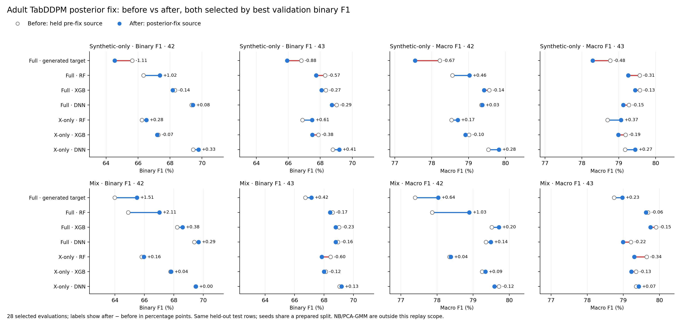

# Adult TabDDPM: best-validation-F1 before and after the posterior fix

Both sides select the earliest maximum development binary F1 within their respective completed histories. The 28 evaluations cover generated targets and full/X-only RF/XGB/DNN, both seeds and training modes. The CSV also includes the corrected run’s loss-selected scores for comparison. NB/PCA-GMM were not replayed.

| Mode | Arm | Seed | Binary F1 before | after | Change (pp) | Macro F1 before | after | Change (pp) |
|---|---|---:|---:|---:|---:|---:|---:|---:|
| synthetic | Full · generated target | 42 | 65.64 | 64.53 | -1.11 | 78.22 | 77.55 | -0.67 |
| synthetic | Full · generated target | 43 | 66.81 | 65.94 | -0.88 | 78.77 | 78.29 | -0.48 |
| synthetic | Full · RF | 42 | 66.34 | 67.36 | +1.02 | 78.56 | 79.02 | +0.46 |
| synthetic | Full · RF | 43 | 68.30 | 67.74 | -0.57 | 79.56 | 79.26 | -0.31 |
| synthetic | Full · XGB | 42 | 68.30 | 68.17 | -0.14 | 79.56 | 79.42 | -0.14 |
| synthetic | Full · XGB | 43 | 68.34 | 68.08 | -0.27 | 79.57 | 79.44 | -0.13 |
| synthetic | Full · DNN | 42 | 69.35 | 69.44 | +0.08 | 79.35 | 79.37 | +0.03 |
| synthetic | Full · DNN | 43 | 69.02 | 68.73 | -0.29 | 79.27 | 79.12 | -0.15 |
| synthetic | X-only · RF | 42 | 66.24 | 66.52 | +0.28 | 78.54 | 78.71 | +0.17 |
| synthetic | X-only · RF | 43 | 66.89 | 67.50 | +0.61 | 78.70 | 79.06 | +0.37 |
| synthetic | X-only · XGB | 42 | 67.27 | 67.20 | -0.07 | 79.01 | 78.92 | -0.10 |
| synthetic | X-only · XGB | 43 | 67.88 | 67.50 | -0.38 | 79.18 | 78.99 | -0.19 |
| synthetic | X-only · DNN | 42 | 69.44 | 69.78 | +0.33 | 79.54 | 79.82 | +0.28 |
| synthetic | X-only · DNN | 43 | 68.79 | 69.20 | +0.41 | 79.17 | 79.45 | +0.27 |
| mix | Full · generated target | 42 | 63.98 | 65.49 | +1.51 | 77.39 | 78.04 | +0.64 |
| mix | Full · generated target | 43 | 66.73 | 67.15 | +0.42 | 78.74 | 78.97 | +0.23 |
| mix | Full · RF | 42 | 64.91 | 67.02 | +2.11 | 77.87 | 78.90 | +1.03 |
| mix | Full · RF | 43 | 68.58 | 68.41 | -0.17 | 79.68 | 79.63 | -0.06 |
| mix | Full · XGB | 42 | 68.23 | 68.60 | +0.38 | 79.52 | 79.71 | +0.20 |
| mix | Full · XGB | 43 | 69.03 | 68.80 | -0.23 | 79.91 | 79.75 | -0.15 |
| mix | Full · DNN | 42 | 69.39 | 69.68 | +0.29 | 79.35 | 79.49 | +0.14 |
| mix | Full · DNN | 43 | 68.95 | 68.79 | -0.16 | 79.21 | 78.99 | -0.22 |
| mix | X-only · RF | 42 | 65.82 | 65.98 | +0.16 | 78.35 | 78.38 | +0.04 |
| mix | X-only · RF | 43 | 68.44 | 67.84 | -0.60 | 79.64 | 79.31 | -0.34 |
| mix | X-only · XGB | 42 | 67.78 | 67.82 | +0.04 | 79.25 | 79.34 | +0.09 |
| mix | X-only · XGB | 43 | 68.12 | 68.01 | -0.12 | 79.35 | 79.22 | -0.13 |
| mix | X-only · DNN | 42 | 69.49 | 69.49 | +0.00 | 79.71 | 79.59 | -0.12 |
| mix | X-only · DNN | 43 | 69.06 | 69.19 | +0.13 | 79.35 | 79.43 | +0.07 |
