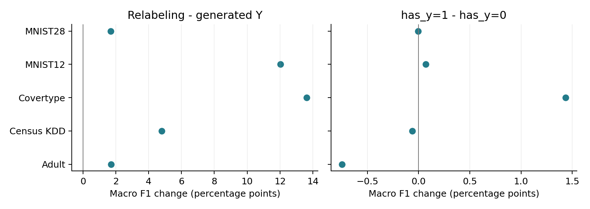

# 1. Mix: real + synthetic: design and factors

**Research question:** What choices does the experiment vary?

**Method:** Analyze this training dataset independently. The factorial grid is 5 datasets x 2 generators x 2 has_y values x 3 labelers x 2 seeds = 120 macro-F1 scores.

**Conclusion:** All relabeled combinations are observed. The 20 generated-target runs and 10 real-only classification runs remain reference comparisons, outside this factorial ANOVA.

| Factor | Meaning | Levels |
| --- | --- | --- |
| dataset | Real-data prediction task. | Adult; Census KDD; Covertype; MNIST12; MNIST28. |
| generator | Model fitted on real training data to generate synthetic rows. | CTGAN; TVAE. |
| has_y | Whether the generator is fitted with target Y. | 0: fit X only. 1: fit (X,Y). |
| labeler | Predictor fitted on real training data to replace synthetic targets. | RF: random forest. XGB: XGBoost. DNN: neural network. |
| seed | Categorical experiment random-number setting. | 42; 43. This is not a continuous covariate. |

| Reference | Construction | Role |
| --- | --- | --- |
| Generated targets | Fit (X,Y), retain generated Y. No labeler. | Two generators x two seeds x five tasks = 20 scores. |
| Real only | Train downstream model on original real training rows. | Two seeds x five tasks = 10 scores. |

**Training rows:** all real training rows plus 100000 synthetic rows. Mix concatenates all rows; it is not a fixed 50/50 mixture. Both reports use the same experimental scope, with separate statistical fits.

**X** = features; **Y** = target. has_y describes generator fitting, not whether the final training table contains Y. Every relabeled table contains X and predicted Y. Generated targets have no has_y=0 case and no labeler; that nonexistent combination is never estimated.

**Macro F1** is the equal-weight average of F1 across target classes, on a 0-1 scale. The downstream evaluator is a dataset-specific neural model. RF/XGB/DNN are labelers. News and Housing regression scores are analyzed separately on page 5.

# 2. ANOVA: which factors affect macro F1?

**Research question:** Do generator, has_y, labeler, seed or their interactions change relabeled-data utility?

**Method:** Type II ANOVA: macro_F1 ~ dataset + generator * has_y * labeler * seed. All five factors are categorical; sum-to-zero coding is used.

**Conclusion:** **Labeler differs** (nominal p = 7.85e-06). Generator and has_y have small average effects; seed and treatment interactions are nonsignificant in this model.

```text
macro_F1 ~ dataset + generator * has_y * labeler * seed
```

| Term | SS | df | F | Nominal p | Sig. |
| --- | --- | --- | --- | --- | --- |
| **dataset** | **1.8170** | **4** | **302.08** | **5.36e-52** | **\*\*\*** |
| generator | 4.27e-09 | 1 | 2.84e-06 | 0.9987 |  |
| has_y | 0.0001 | 1 | 0.04 | 0.8459 |  |
| **labeler** | **0.0403** | **2** | **13.39** | **7.85e-06** | **\*\*\*** |
| seed | 4.81e-05 | 1 | 0.03 | 0.8584 |  |
| generator x has_y | 0.0001 | 1 | 0.05 | 0.8276 |  |
| generator x labeler | 0.0001 | 2 | 0.02 | 0.9786 |  |
| has_y x labeler | 0.0002 | 2 | 0.07 | 0.9292 |  |
| generator x seed | 3.55e-05 | 1 | 0.02 | 0.8782 |  |
| has_y x seed | 0.0002 | 1 | 0.16 | 0.6943 |  |
| labeler x seed | 0.0002 | 2 | 0.06 | 0.9417 |  |
| generator x has_y x labeler | 0.0002 | 2 | 0.08 | 0.9215 |  |
| generator x has_y x seed | 1.05e-05 | 1 | 0.01 | 0.9336 |  |
| generator x labeler x seed | 0.0004 | 2 | 0.14 | 0.8659 |  |
| has_y x labeler x seed | 0.0007 | 2 | 0.23 | 0.7977 |  |
| generator x has_y x labeler x seed | 0.0002 | 2 | 0.05 | 0.9495 |  |
| Residual | 0.1383 | 92 |  |  |  |

Symbols: \*\*\* p < .001; \*\* p < .01; \* p < .05; . p < .10. Bold: p < .05. Uses nominal Type II ANOVA p.

* includes all main effects, two-way, three-way and four-way interactions among generator, has_y, labeler and seed. For example, has_y x labeler asks whether including Y helps RF, XGB and DNN differently. Dataset is an additive block in this equation.

| Marginal comparison | Mean F1 change | 95% model CI |
| --- | --- | --- |
| TVAE - CTGAN | +1.19e-05 | [-0.0140, +0.0141] |
| has_y=1 - has_y=0 | +0.0014 | [-0.0127, +0.0154] |
| Seed 43 - seed 42 | +0.0013 | [-0.0128, +0.0153] |

SS = sum of squares; df = numerator degrees of freedom; F = term mean square / residual mean square. Residual df = 92. Intervals use the ordinary model assumptions and are unadjusted. Shared test partitions make nominal ANOVA inference exploratory.

# 3. Does replacing generated targets improve utility?

**Research question:** Do RF/XGB/DNN targets outperform the generator's own targets, and does has_y matter?

**Method:** Match within dataset, seed and generator. delta[d] = mean(s,g,labeler) F1_relabel[d] - mean(s,g) F1_generated[d]. Test five dataset differences with t = mean(delta)/(SD(delta)/sqrt(5)), df=4.

**Conclusion:** Relabeling gains **+0.0677 macro F1 (9.04% relative)**. has_y=1 minus 0 is **+0.0014**. Neither main comparison passes Holm-adjusted p < .05 across tasks.

| Comparison | First mean | Second mean | F1 change | Relative |
| --- | --- | --- | --- | --- |
| Relabeled - generated | 0.8166 | 0.7488 | +0.0677 | 9.04% |
| has_y=1 - has_y=0 | 0.8172 | 0.8159 | +0.0014 | 0.17% |
| has_y=1 - generated | 0.8172 | 0.7488 | +0.0684 | 9.14% |
| has_y=0 - generated | 0.8159 | 0.7488 | +0.0670 | 8.95% |

| Comparison | 95% paired-t CI | Holm p | Sig. |
| --- | --- | --- | --- |
| Relabeled - generated | [-0.0031, +0.1385] | 0.1997 |  |
| has_y=1 - has_y=0 | [-0.0085, +0.0113] | 0.7182 |  |
| has_y=1 - generated | [-0.0063, +0.1431] | 0.1997 |  |
| has_y=0 - generated | [+3.20e-05, +0.1340] | 0.1997 |  |

Symbols: \*\*\* p < .001; \*\* p < .01; \* p < .05; . p < .10. Bold: p < .05. Uses Holm-adjusted dataset-level p over four planned contrasts.

**Why the gain misses Holm significance:** the five task gains range from 1.70 to 13.63 percentage points; SE = 2.55 points. Raw p = 0.0566; Holm p = 0.1997. The smallest of four raw p-values is 0.0499, above the first Holm cutoff .05/4 = .0125. None passes. Large gains do not imply precise estimates.

Five dataset means show the main contrasts. Positive values favor relabeling or has_y=1.



All datasets, seeds and generators receive equal weight; relabeling also averages the three labelers. has_y compares only relabeled runs. The generated baseline is matched once per dataset/seed/generator and is not treated as six independent copies.

Relative gain = F1 change / second mean; .01 F1 is one percentage point. Confidence intervals are unadjusted. Exact sign-flip results are supplied; with five tasks the minimum two-sided p is .0625. This is not evidence that every future task improves.

# 4. How large is each labeler's improvement?

**Research question:** For each generator and has_y, how much do RF, XGB and DNN improve on generated targets?

**Method:** delta[d] = mean(s) F1_relabel[d,g,has_y,labeler] - mean(s) F1_generated[d,g]. Paired t-test across five datasets, df=4; Holm over twelve comparisons.

**Conclusion:** Largest descriptive gain: CTGAN / DNN / has_y=1 (**+0.1277**). 0 of twelve baseline comparisons pass Holm-adjusted p < .05.

| Generator | Labeler | has_y | F1 mean | F1 gain | Relative | Holm p | Sig. |
| --- | --- | --- | --- | --- | --- | --- | --- |
| CTGAN | RF | 0 | 0.8023 | +0.0857 | 11.97% | 0.9319 |  |
| CTGAN | XGB | 0 | 0.8068 | +0.0902 | 12.59% | 0.9319 |  |
| CTGAN | DNN | 0 | 0.8408 | +0.1243 | 17.34% | 0.8734 |  |
| CTGAN | RF | 1 | 0.7958 | +0.0793 | 11.06% | 0.9319 |  |
| CTGAN | XGB | 1 | 0.8094 | +0.0928 | 12.96% | 0.9319 |  |
| CTGAN | DNN | 1 | 0.8442 | +0.1277 | 17.82% | 0.8782 |  |
| TVAE | RF | 0 | 0.7971 | +0.0160 | 2.05% | 0.9319 |  |
| TVAE | XGB | 0 | 0.8066 | +0.0255 | 3.26% | 0.9319 |  |
| TVAE | DNN | 0 | 0.8416 | +0.0605 | 7.75% | 0.9319 |  |
| TVAE | RF | 1 | 0.8000 | +0.0189 | 2.42% | 0.9319 |  |
| TVAE | XGB | 1 | 0.8136 | +0.0325 | 4.16% | 0.9319 |  |
| TVAE | DNN | 1 | 0.8405 | +0.0594 | 7.60% | 0.9319 |  |

Symbols: \*\*\* p < .001; \*\* p < .01; \* p < .05; . p < .10. Bold: p < .05. Uses Holm-adjusted dataset-level p across twelve baseline comparisons.

| Matched generated-target comparator | Mean macro F1 |
| --- | --- |
| CTGAN | 0.7165 |
| TVAE | 0.7811 |

These are comparisons against each generator's own generated targets, not pairwise tests between labelers. The labeler ANOVA on page 2 tests differences among RF/XGB/DNN. An observed largest gain does not establish a universally best labeler.

Means average seeds within tasks and then give each task equal weight. Per-task differences, confidence intervals, exact tests and fitted marginal means are in the supplied tables. Generated baselines remain outside the factorial fit.

# 5. Regression: what changes on News and Housing?

**Research question:** Does relabeling improve regression utility under the same constructions?

**Method:** Compare saved scores with generated targets. Means average seeds, generators and, for relabeled runs, RF/XGB/DNN. Pages 7-8 separately test factor effects within relabeled runs.

**Conclusion:** Housing relabeling improves all three average metrics. News relabeling improves R2 but worsens NMAE and D2. Baseline gains below are descriptive; ANOVA tests are exploratory.

```text
R2 = 1 - sum((Y - prediction)^2) / sum((Y - mean(Y))^2)
```

```text
NMAE = mean(abs(Y - prediction)) / SD_test(Y), ddof = 0
```

```text
D2 = 1 - MAE_prediction / MAE_test_median_baseline
```

| Dataset / metric | Real only | Generated Y | Relabeled has_y=0 | Relabeled has_y=1 |
| --- | --- | --- | --- | --- |
| News / R2 | -0.0290 | -0.0196 | 0.0002 | -0.0008 |
| News / NMAE | 0.2686 | 0.2494 | 0.2551 | 0.2544 |
| News / D2 | -0.0445 | 0.0300 | 0.0079 | 0.0104 |
| Housing / R2 | 0.5125 | 0.6676 | 0.7905 | 0.7872 |
| Housing / NMAE | 0.5507 | 0.4137 | 0.3103 | 0.3052 |
| Housing / D2 | 0.2822 | 0.4607 | 0.5956 | 0.6022 |

| Relabeled - generated | R2 change | D2 change |
| --- | --- | --- |
| News | +0.0192 | -0.0208 |
| Housing | +0.1212 | +0.1382 |

Higher R2/D2 is better; lower NMAE is better. R2 measures squared error against the test-mean baseline; D2 measures absolute error against the test-median baseline. Negative R2/D2 means worse than that baseline.

News uses log-target reruns scored in original units; Housing uses no-Faker reruns. NMAE and D2 read saved test normalization and verified sidecars; denominators are not recomputed for this report. Real-only runs are references.

**Scope:** 406 verified selected records across both training analyses: 290 classification and 116 regression, plus 116 verified D2 sidecars. The 14 real-only runs are shared references. Credit, Intrusion, NB/PCA-GMM and simulated experiments are excluded.

**MNIST caveat:** output heads were repaired; retained MNIST12 TVAE synthetic tables still have documented holdout-feature collisions. Seeds share prepared test partitions. Neither seed supplies an independent new test sample.

# 6. Model checks: do common effects describe each task?

**Research question:** Do classification effects vary by task, and which regression factors matter within News or Housing?

**Method:** Use nested F tests for the classification equations below. For each regression dataset, fit R2 or D2 ~ seed + generator * has_y * labeler.

**Conclusion:** Classification dataset interactions are strong (p = 2.93e-32). Regression effects also depend on the task; use the within-task p-values below and signed changes on pages 7-8.

```text
Seed block: macro_F1 ~ dataset + seed + generator * has_y * labeler
```

```text
Dataset check: macro_F1 ~ dataset * (has_y * labeler)
```

```text
                         + generator * has_y * labeler + seed
```

| Added terms | df num / den | F | Nominal p | Sig. |
| --- | --- | --- | --- | --- |
| Seed interactions | 11 / 92 | 0.105 | 0.9999 |  |
| **Dataset interactions** | **20 / 83** | **35.220** | **2.93e-32** | **\*\*\*** |

Symbols: \*\*\* p < .001; \*\* p < .01; \* p < .05; . p < .10. Bold: p < .05. Uses nominal nested-model p; these are supporting checks.

```text
Within each regression dataset: R2 or D2 ~ seed + generator * has_y * labeler
```

| Dataset / outcome | Generator p | has_y p | Labeler p | Seed p |
| --- | --- | --- | --- | --- |
| News / R2 | 0.5895  | 0.2084  | 0.1594  | 0.9051  |
| Housing / R2 | **0.0037 \*\*** | 0.4679  | **0.0066 \*\*** | 0.5729  |
| News / D2 | 0.3946  | 0.4105  | 0.0856 . | 0.1115  |
| Housing / D2 | **8.22e-05 \*\*\*** | **0.0140 \*** | **6.35e-08 \*\*\*** | 0.9061  |

Symbols: \*\*\* p < .001; \*\* p < .01; \* p < .05; . p < .10. Bold: p < .05. Uses nominal within-task ANOVA p; bold cells mark p < .05.

Each regression task has 24 relabeled scores, 13 coefficients and 11 residual df. A full generator * has_y * labeler * seed fit within one task would be saturated: 24 coefficients, zero residual df. The stated within-task equation keeps seed additive; its omitted seed interactions form the residual. Full tables are supplied.

Primary model: 120 scores, 28 identifiable coefficients, 92 residual df. Seed-block rank = 17; dataset-check rank = 37. All ANOVA F values were independently reproduced. Primary residual Shapiro p = 3.30e-07; adjusted R-squared = 0.9104.

The ordinary ANOVA assumes independent errors with common variance. Shared test sets, nonnormal residuals and dataset-specific treatment effects limit its p-values; page 3 therefore reports paired evidence across five dataset means. Seed is fixed at 42/43, not a sampled population of seeds.

**Provenance:** original score snapshot Oct 10, 2026, 1:08:42 a.m. Chicago; all 522 source/sidecar hashes rechecked Oct 10, 2026 at 02:53 PM Chicago. Generator settings remain 500 epochs and 100,000 rows. Census selects checkpoints by weighted macro-F1; others use development loss. Experiments were not rerun.

# 7. Regression ANOVA: which factors affect R2?

**Research question:** Among relabeled runs, do generator, has_y, labeler, seed or their interactions change R2?

**Method:** Type II ANOVA: R2 ~ dataset + generator * has_y * labeler * seed. All factors are categorical with sum-to-zero coding; synthetic and mix are fitted independently.

**Conclusion:** Nominal main effects: generator (p = 0.0423), labeler (p = 0.0499). has_y has no detected common effect; a significant term means choices differ, not that every choice improves utility.

```text
R2 ~ dataset + generator * has_y * labeler * seed
```

| Term | SS | df | F | Nominal p | Partial eta2 | Sig. |
| --- | --- | --- | --- | --- | --- | --- |
| **dataset** | **7.4735** | **1** | **45951.90** | **1.81e-39** | **0.999** | **\*\*\*** |
| **generator** | **0.0008** | **1** | **4.62** | **0.0423** | **0.167** | **\*** |
| has_y | 0.0001 | 1 | 0.35 | 0.5589 | 0.015 |  |
| **labeler** | **0.0011** | **2** | **3.43** | **0.0499** | **0.230** | **\*** |
| seed | 2.14e-05 | 1 | 0.13 | 0.7202 | 0.006 |  |
| generator x has_y | 2.32e-06 | 1 | 0.01 | 0.9060 | 0.001 |  |
| generator x labeler | 0.0004 | 2 | 1.35 | 0.2788 | 0.105 |  |
| has_y x labeler | 0.0004 | 2 | 1.24 | 0.3086 | 0.097 |  |
| generator x seed | 1.09e-05 | 1 | 0.07 | 0.7976 | 0.003 |  |
| has_y x seed | 0.0001 | 1 | 0.46 | 0.5058 | 0.019 |  |
| labeler x seed | 0.0003 | 2 | 1.04 | 0.3704 | 0.083 |  |
| generator x has_y x labeler | 0.0005 | 2 | 1.55 | 0.2333 | 0.119 |  |
| generator x has_y x seed | 1.72e-05 | 1 | 0.11 | 0.7480 | 0.005 |  |
| generator x labeler x seed | 9.93e-07 | 2 | 3.05e-03 | 0.9970 | 2.65e-04 |  |
| has_y x labeler x seed | 0.0003 | 2 | 0.88 | 0.4296 | 0.071 |  |
| generator x has_y x labeler x seed | 3.01e-05 | 2 | 0.09 | 0.9120 | 0.008 |  |
| Residual | 0.0037 | 23 |  |  |  |  |

Symbols: \*\*\* p < .001; \*\* p < .01; \* p < .05; . p < .10. Bold: p < .05. Uses nominal exploratory ANOVA p; no multiplicity adjustment.

| Marginal comparison | Pooled change | News change | Housing change |
| --- | --- | --- | --- |
| TVAE - CTGAN | -0.0079 | +0.0004 | -0.0163 |
| has_y=1 - has_y=0 | -0.0022 | -0.0010 | -0.0033 |
| Seed 43 - seed 42 | -0.0013 | -0.0001 | -0.0026 |
| RF - DNN | -0.0098 | -0.0020 | -0.0177 |
| XGB - DNN | +0.0008 | -0.0010 | +0.0026 |

Positive changes favor the first choice. Pooled changes give the two tasks equal weight. Within-task model p-values are on page 6; unadjusted 95% model intervals and contrast p-values are supplied in regression_factor_effects.csv.

48 observed scores; 25 identifiable coefficients; 23 residual df. Partial eta2 = SS_term / (SS_term + SS_residual). These exploratory tests use two fixed datasets and shared test partitions. They do not test relabeled versus generated targets; those baseline changes are on page 5. Dataset SS reflects different task score levels.

# 8. Regression ANOVA: which factors affect D2?

**Research question:** Among relabeled runs, do generator, has_y, labeler, seed or their interactions change D2?

**Method:** Type II ANOVA: D2 ~ dataset + generator * has_y * labeler * seed. All factors are categorical with sum-to-zero coding; synthetic and mix are fitted independently.

**Conclusion:** Nominal main effects: labeler (p = 0.0005). has_y has no detected common effect; a significant term means choices differ, not that every choice improves utility.

```text
D2 ~ dataset + generator * has_y * labeler * seed
```

| Term | SS | df | F | Nominal p | Partial eta2 | Sig. |
| --- | --- | --- | --- | --- | --- | --- |
| **dataset** | **4.1732** | **1** | **22153.69** | **7.92e-36** | **0.999** | **\*\*\*** |
| generator | 0.0008 | 1 | 4.27 | 0.0503 | 0.157 | . |
| has_y | 0.0003 | 1 | 1.33 | 0.2605 | 0.055 |  |
| **labeler** | **0.0040** | **2** | **10.66** | **0.0005** | **0.481** | **\*\*\*** |
| seed | 0.0001 | 1 | 0.45 | 0.5071 | 0.019 |  |
| generator x has_y | 2.81e-05 | 1 | 0.15 | 0.7030 | 0.006 |  |
| generator x labeler | 0.0004 | 2 | 1.11 | 0.3479 | 0.088 |  |
| has_y x labeler | 0.0001 | 2 | 0.21 | 0.8090 | 0.018 |  |
| generator x seed | 4.68e-05 | 1 | 0.25 | 0.6229 | 0.011 |  |
| has_y x seed | 0.0001 | 1 | 0.45 | 0.5090 | 0.019 |  |
| labeler x seed | 0.0001 | 2 | 0.16 | 0.8501 | 0.014 |  |
| generator x has_y x labeler | 4.73e-05 | 2 | 0.13 | 0.8825 | 0.011 |  |
| generator x has_y x seed | 0.0001 | 1 | 0.47 | 0.5012 | 0.020 |  |
| generator x labeler x seed | 1.47e-05 | 2 | 0.04 | 0.9618 | 0.003 |  |
| has_y x labeler x seed | 2.13e-05 | 2 | 0.06 | 0.9453 | 0.005 |  |
| generator x has_y x labeler x seed | 1.69e-05 | 2 | 0.04 | 0.9561 | 0.004 |  |
| Residual | 0.0043 | 23 |  |  |  |  |

Symbols: \*\*\* p < .001; \*\* p < .01; \* p < .05; . p < .10. Bold: p < .05. Uses nominal exploratory ANOVA p; no multiplicity adjustment.

| Marginal comparison | Pooled change | News change | Housing change |
| --- | --- | --- | --- |
| TVAE - CTGAN | -0.0082 | -0.0026 | -0.0138 |
| has_y=1 - has_y=0 | +0.0046 | +0.0025 | +0.0066 |
| Seed 43 - seed 42 | +0.0027 | +0.0051 | +0.0003 |
| RF - DNN | -0.0190 | -0.0081 | -0.0299 |
| XGB - DNN | +0.0008 | -0.0073 | +0.0089 |

Positive changes favor the first choice. Pooled changes give the two tasks equal weight. Within-task model p-values are on page 6; unadjusted 95% model intervals and contrast p-values are supplied in regression_factor_effects.csv.

48 observed scores; 25 identifiable coefficients; 23 residual df. Partial eta2 = SS_term / (SS_term + SS_residual). These exploratory tests use two fixed datasets and shared test partitions. They do not test relabeled versus generated targets; those baseline changes are on page 5. Dataset SS reflects different task score levels.
