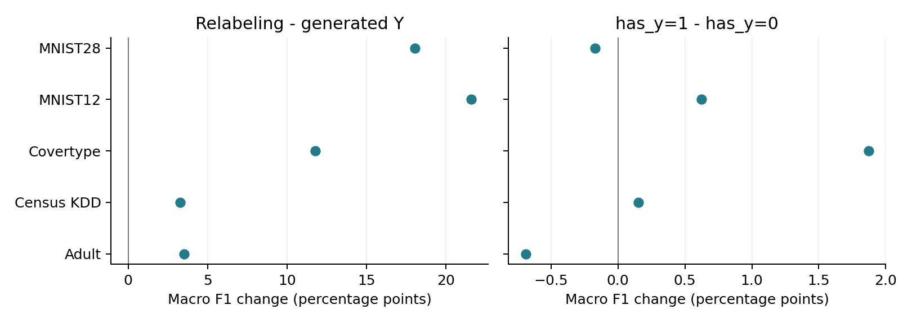

# 1. Synthetic-only: design and factors

**Research question:** What choices does the experiment vary?

**Method:** Analyze this training dataset independently. The factorial grid is 5 datasets x 2 generators x 2 has_y values x 3 labelers x 2 seeds = 120 macro-F1 scores.

**Conclusion:** All relabeled combinations are observed. The 20 generated-target runs and 10 real-only classification runs remain reference comparisons, outside this factorial ANOVA.

| Factor | Meaning | Levels |
| --- | --- | --- |
| dataset | Real-data prediction task. | Adult; Census KDD; Covertype; MNIST12; MNIST28. |
| generator | Model fitted on real training data to generate synthetic rows. | CTGAN; TVAE. |
| has_y | Whether the generator is fitted with target Y. | 0: fit X only. 1: fit (X,Y). |
| labeler | Predictor fitted on real training data to replace synthetic targets. | RF: random forest. XGB: XGBoost. DNN: neural network. |
| seed | Categorical experiment random-number setting. | 42; 43. This is not a continuous covariate. |

| Reference | Construction | Role |
| --- | --- | --- |
| Generated targets | Fit (X,Y), retain generated Y. No labeler. | Two generators x two seeds x five tasks = 20 scores. |
| Real only | Train downstream model on original real training rows. | Two seeds x five tasks = 10 scores. |

**Training rows:** 100000 synthetic rows only. Mix concatenates all rows; it is not a fixed 50/50 mixture. Both reports use the same experimental scope, with separate statistical fits.

**X** = features; **Y** = target. has_y describes generator fitting, not whether the final training table contains Y. Every relabeled table contains X and predicted Y. Generated targets have no has_y=0 case and no labeler; that nonexistent combination is never estimated.

**Macro F1** is the equal-weight average of F1 across target classes, on a 0-1 scale. The downstream evaluator is a dataset-specific neural model. RF/XGB/DNN are labelers. News and Housing regression scores are analyzed separately on page 5.

# 2. ANOVA: which factors affect macro F1?

**Research question:** Do generator, has_y, labeler, seed or their interactions change relabeled-data utility?

**Method:** Type II ANOVA: macro_F1 ~ dataset + generator * has_y * labeler * seed. All five factors are categorical; sum-to-zero coding is used.

**Conclusion:** **Labeler differs** (nominal p = 1.03e-05). Generator and has_y have small average effects; seed and treatment interactions are nonsignificant in this model.

```text
macro_F1 ~ dataset + generator * has_y * labeler * seed
```

| Term | SS | df | F | Nominal p | Sig. |
| --- | --- | --- | --- | --- | --- |
| **dataset** | **2.1890** | **4** | **266.10** | **1.17e-49** | **\*\*\*** |
| generator | 0.0002 | 1 | 0.08 | 0.7746 |  |
| has_y | 0.0004 | 1 | 0.19 | 0.6671 |  |
| **labeler** | **0.0536** | **2** | **13.04** | **1.03e-05** | **\*\*\*** |
| seed | 3.77e-05 | 1 | 0.02 | 0.8926 |  |
| generator x has_y | 1.99e-05 | 1 | 0.01 | 0.9219 |  |
| generator x labeler | 0.0001 | 2 | 0.03 | 0.9667 |  |
| has_y x labeler | 0.0001 | 2 | 0.02 | 0.9813 |  |
| generator x seed | 0.0006 | 1 | 0.31 | 0.5790 |  |
| has_y x seed | 0.0003 | 1 | 0.13 | 0.7227 |  |
| labeler x seed | 0.0003 | 2 | 0.07 | 0.9348 |  |
| generator x has_y x labeler | 0.0001 | 2 | 0.03 | 0.9667 |  |
| generator x has_y x seed | 3.61e-05 | 1 | 0.02 | 0.8949 |  |
| generator x labeler x seed | 0.0007 | 2 | 0.17 | 0.8406 |  |
| has_y x labeler x seed | 0.0006 | 2 | 0.16 | 0.8555 |  |
| generator x has_y x labeler x seed | 0.0001 | 2 | 0.02 | 0.9844 |  |
| Residual | 0.1892 | 92 |  |  |  |

Symbols: \*\*\* p < .001; \*\* p < .01; \* p < .05; . p < .10. Bold: p < .05. Uses nominal Type II ANOVA p.

* includes all main effects, two-way, three-way and four-way interactions among generator, has_y, labeler and seed. For example, has_y x labeler asks whether including Y helps RF, XGB and DNN differently. Dataset is an additive block in this equation.

| Marginal comparison | Mean F1 change | 95% model CI |
| --- | --- | --- |
| TVAE - CTGAN | +0.0024 | [-0.0141, +0.0188] |
| has_y=1 - has_y=0 | +0.0036 | [-0.0129, +0.0200] |
| Seed 43 - seed 42 | -0.0011 | [-0.0176, +0.0153] |

SS = sum of squares; df = numerator degrees of freedom; F = term mean square / residual mean square. Residual df = 92. Intervals use the ordinary model assumptions and are unadjusted. Shared test partitions make nominal ANOVA inference exploratory.

# 3. Does replacing generated targets improve utility?

**Research question:** Do RF/XGB/DNN targets outperform the generator's own targets, and does has_y matter?

**Method:** Match within dataset, seed and generator. delta[d] = mean(s,g,labeler) F1_relabel[d] - mean(s,g) F1_generated[d]. Test five dataset differences with t = mean(delta)/(SD(delta)/sqrt(5)), df=4.

**Conclusion:** Relabeling gains **+0.1163 macro F1 (17.38% relative)**. has_y=1 minus 0 is **+0.0036**. Neither main comparison passes Holm-adjusted p < .05 across tasks.

| Comparison | First mean | Second mean | F1 change | Relative |
| --- | --- | --- | --- | --- |
| Relabeled - generated | 0.7855 | 0.6692 | +0.1163 | 17.38% |
| has_y=1 - has_y=0 | 0.7873 | 0.7837 | +0.0036 | 0.46% |
| has_y=1 - generated | 0.7873 | 0.6692 | +0.1181 | 17.65% |
| has_y=0 - generated | 0.7837 | 0.6692 | +0.1145 | 17.11% |

| Comparison | 95% paired-t CI | Holm p | Sig. |
| --- | --- | --- | --- |
| Relabeled - generated | [+0.0133, +0.2193] | 0.1397 |  |
| has_y=1 - has_y=0 | [-0.0085, +0.0156] | 0.4575 |  |
| has_y=1 - generated | [+0.0132, +0.2230] | 0.1397 |  |
| has_y=0 - generated | [+0.0132, +0.2159] | 0.1397 |  |

Symbols: \*\*\* p < .001; \*\* p < .01; \* p < .05; . p < .10. Bold: p < .05. Uses Holm-adjusted dataset-level p over four planned contrasts.

**Why the gain misses Holm significance:** the five task gains range from 3.28 to 21.58 percentage points; SE = 3.71 points. Raw p = 0.0350; Holm p = 0.1397. The smallest of four raw p-values is 0.0349, above the first Holm cutoff .05/4 = .0125. None passes. Large gains do not imply precise estimates.

Five dataset means show the main contrasts. Positive values favor relabeling or has_y=1.



All datasets, seeds and generators receive equal weight; relabeling also averages the three labelers. has_y compares only relabeled runs. The generated baseline is matched once per dataset/seed/generator and is not treated as six independent copies.

Relative gain = F1 change / second mean; .01 F1 is one percentage point. Confidence intervals are unadjusted. Exact sign-flip results are supplied; with five tasks the minimum two-sided p is .0625. This is not evidence that every future task improves.

# 4. How large is each labeler's improvement?

**Research question:** For each generator and has_y, how much do RF, XGB and DNN improve on generated targets?

**Method:** delta[d] = mean(s) F1_relabel[d,g,has_y,labeler] - mean(s) F1_generated[d,g]. Paired t-test across five datasets, df=4; Holm over twelve comparisons.

**Conclusion:** Largest descriptive gain: CTGAN / DNN / has_y=1 (**+0.2287**). 0 of twelve baseline comparisons pass Holm-adjusted p < .05.

| Generator | Labeler | has_y | F1 mean | F1 gain | Relative | Holm p | Sig. |
| --- | --- | --- | --- | --- | --- | --- | --- |
| CTGAN | RF | 0 | 0.7670 | +0.1778 | 30.18% | 0.6281 |  |
| CTGAN | XGB | 0 | 0.7664 | +0.1772 | 30.08% | 0.6281 |  |
| CTGAN | DNN | 0 | 0.8130 | +0.2239 | 37.99% | 0.5217 |  |
| CTGAN | RF | 1 | 0.7666 | +0.1774 | 30.11% | 0.6281 |  |
| CTGAN | XGB | 1 | 0.7752 | +0.1860 | 31.56% | 0.6281 |  |
| CTGAN | DNN | 1 | 0.8179 | +0.2287 | 38.82% | 0.5217 |  |
| TVAE | RF | 0 | 0.7676 | +0.0184 | 2.45% | 0.6281 |  |
| TVAE | XGB | 0 | 0.7746 | +0.0254 | 3.38% | 0.3208 |  |
| TVAE | DNN | 0 | 0.8138 | +0.0645 | 8.61% | 0.6281 |  |
| TVAE | RF | 1 | 0.7711 | +0.0219 | 2.92% | 0.5687 |  |
| TVAE | XGB | 1 | 0.7768 | +0.0275 | 3.67% | 0.1625 |  |
| TVAE | DNN | 1 | 0.8164 | +0.0672 | 8.97% | 0.6281 |  |

Symbols: \*\*\* p < .001; \*\* p < .01; \* p < .05; . p < .10. Bold: p < .05. Uses Holm-adjusted dataset-level p across twelve baseline comparisons.

| Matched generated-target comparator | Mean macro F1 |
| --- | --- |
| CTGAN | 0.5892 |
| TVAE | 0.7492 |

These are comparisons against each generator's own generated targets, not pairwise tests between labelers. The labeler ANOVA on page 2 tests differences among RF/XGB/DNN. An observed largest gain does not establish a universally best labeler.

Means average seeds within tasks and then give each task equal weight. Per-task differences, confidence intervals, exact tests and fitted marginal means are in the supplied tables. Generated baselines remain outside the factorial fit.

# 5. Regression: what changes on News and Housing?

**Research question:** Does relabeling improve regression utility under the same constructions?

**Method:** Compare saved scores with generated targets. Means average seeds, generators and, for relabeled runs, RF/XGB/DNN. Pages 7-8 separately test factor effects within relabeled runs.

**Conclusion:** Housing relabeling improves all three average metrics. News relabeling improves R2 but worsens NMAE and D2. Baseline gains below are descriptive; ANOVA tests are exploratory.

```text
R2 = 1 - sum((Y - prediction)^2) / sum((Y - mean(Y))^2)
```

```text
NMAE = mean(abs(Y - prediction)) / SD_test(Y), ddof = 0
```

```text
D2 = 1 - MAE_prediction / MAE_test_median_baseline
```

| Dataset / metric | Real only | Generated Y | Relabeled has_y=0 | Relabeled has_y=1 |
| --- | --- | --- | --- | --- |
| News / R2 | -0.0290 | -0.0235 | 0.0027 | -0.0004 |
| News / NMAE | 0.2686 | 0.2546 | 0.2597 | 0.2587 |
| News / D2 | -0.0445 | 0.0099 | -0.0098 | -0.0060 |
| Housing / R2 | 0.5125 | 0.6730 | 0.7946 | 0.7930 |
| Housing / NMAE | 0.5507 | 0.4146 | 0.3049 | 0.3022 |
| Housing / D2 | 0.2822 | 0.4595 | 0.6025 | 0.6061 |

| Relabeled - generated | R2 change | D2 change |
| --- | --- | --- |
| News | +0.0246 | -0.0178 |
| Housing | +0.1208 | +0.1448 |

Higher R2/D2 is better; lower NMAE is better. R2 measures squared error against the test-mean baseline; D2 measures absolute error against the test-median baseline. Negative R2/D2 means worse than that baseline.

News uses log-target reruns scored in original units; Housing uses no-Faker reruns. NMAE and D2 read saved test normalization and verified sidecars; denominators are not recomputed for this report. Real-only runs are references.

**Scope:** 406 verified selected records across both training analyses: 290 classification and 116 regression, plus 116 verified D2 sidecars. The 14 real-only runs are shared references. Credit, Intrusion, NB/PCA-GMM and simulated experiments are excluded.

**MNIST caveat:** output heads were repaired; retained MNIST12 TVAE synthetic tables still have documented holdout-feature collisions. Seeds share prepared test partitions. Neither seed supplies an independent new test sample.

# 6. Model checks: do common effects describe each task?

**Research question:** Do classification effects vary by task, and which regression factors matter within News or Housing?

**Method:** Use nested F tests for the classification equations below. For each regression dataset, fit R2 or D2 ~ seed + generator * has_y * labeler.

**Conclusion:** Classification dataset interactions are strong (p = 1.86e-09). Regression effects also depend on the task; use the within-task p-values below and signed changes on pages 7-8.

```text
Seed block: macro_F1 ~ dataset + seed + generator * has_y * labeler
```

```text
Dataset check: macro_F1 ~ dataset * (has_y * labeler)
```

```text
                         + generator * has_y * labeler + seed
```

| Added terms | df num / den | F | Nominal p | Sig. |
| --- | --- | --- | --- | --- |
| Seed interactions | 11 / 92 | 0.116 | 0.9998 |  |
| **Dataset interactions** | **20 / 83** | **6.042** | **1.86e-09** | **\*\*\*** |

Symbols: \*\*\* p < .001; \*\* p < .01; \* p < .05; . p < .10. Bold: p < .05. Uses nominal nested-model p; these are supporting checks.

```text
Within each regression dataset: R2 or D2 ~ seed + generator * has_y * labeler
```

| Dataset / outcome | Generator p | has_y p | Labeler p | Seed p |
| --- | --- | --- | --- | --- |
| News / R2 | **0.0118 \*** | 0.0704 . | **0.0093 \*\*** | 0.6229  |
| Housing / R2 | 0.0540 . | 0.8662  | **0.0065 \*\*** | 0.1197  |
| News / D2 | **0.0001 \*\*\*** | 0.2442  | 0.1783  | 0.2980  |
| Housing / D2 | **0.0111 \*** | 0.1949  | **3.31e-07 \*\*\*** | 0.1719  |

Symbols: \*\*\* p < .001; \*\* p < .01; \* p < .05; . p < .10. Bold: p < .05. Uses nominal within-task ANOVA p; bold cells mark p < .05.

Each regression task has 24 relabeled scores, 13 coefficients and 11 residual df. A full generator * has_y * labeler * seed fit within one task would be saturated: 24 coefficients, zero residual df. The stated within-task equation keeps seed additive; its omitted seed interactions form the residual. Full tables are supplied.

Primary model: 120 scores, 28 identifiable coefficients, 92 residual df. Seed-block rank = 17; dataset-check rank = 37. All ANOVA F values were independently reproduced. Primary residual Shapiro p = 0.0033; adjusted R-squared = 0.8995.

The ordinary ANOVA assumes independent errors with common variance. Shared test sets, nonnormal residuals and dataset-specific treatment effects limit its p-values; page 3 therefore reports paired evidence across five dataset means. Seed is fixed at 42/43, not a sampled population of seeds.

**Provenance:** original score snapshot Oct 10, 2026, 1:08:42 a.m. Chicago; all 522 source/sidecar hashes rechecked Oct 10, 2026 at 02:53 PM Chicago. Generator settings remain 500 epochs and 100,000 rows. Census selects checkpoints by weighted macro-F1; others use development loss. Experiments were not rerun.

# 7. Regression ANOVA: which factors affect R2?

**Research question:** Among relabeled runs, do generator, has_y, labeler, seed or their interactions change R2?

**Method:** Type II ANOVA: R2 ~ dataset + generator * has_y * labeler * seed. All factors are categorical with sum-to-zero coding; synthetic and mix are fitted independently.

**Conclusion:** No treatment main effect or interaction passes nominal p < .05 in this common-effects model. has_y has no detected common effect; a significant term means choices differ, not that every choice improves utility.

```text
R2 ~ dataset + generator * has_y * labeler * seed
```

| Term | SS | df | F | Nominal p | Partial eta2 | Sig. |
| --- | --- | --- | --- | --- | --- | --- |
| **dataset** | **7.5400** | **1** | **13941.79** | **1.62e-33** | **0.998** | **\*\*\*** |
| generator | 0.0006 | 1 | 1.15 | 0.2947 | 0.048 |  |
| has_y | 0.0001 | 1 | 0.12 | 0.7332 | 0.005 |  |
| labeler | 0.0029 | 2 | 2.71 | 0.0879 | 0.191 | . |
| seed | 0.0006 | 1 | 1.11 | 0.3036 | 0.046 |  |
| generator x has_y | 2.64e-06 | 1 | 4.89e-03 | 0.9449 | 2.12e-04 |  |
| generator x labeler | 0.0012 | 2 | 1.13 | 0.3392 | 0.090 |  |
| has_y x labeler | 4.31e-05 | 2 | 0.04 | 0.9610 | 0.003 |  |
| generator x seed | 0.0003 | 1 | 0.59 | 0.4499 | 0.025 |  |
| has_y x seed | 2.99e-05 | 1 | 0.06 | 0.8161 | 0.002 |  |
| labeler x seed | 0.0005 | 2 | 0.50 | 0.6145 | 0.041 |  |
| generator x has_y x labeler | 4.88e-05 | 2 | 0.05 | 0.9560 | 0.004 |  |
| generator x has_y x seed | 2.72e-06 | 1 | 0.01 | 0.9441 | 2.19e-04 |  |
| generator x labeler x seed | 0.0011 | 2 | 1.06 | 0.3633 | 0.084 |  |
| has_y x labeler x seed | 0.0001 | 2 | 0.09 | 0.9185 | 0.007 |  |
| generator x has_y x labeler x seed | 0.0001 | 2 | 0.12 | 0.8881 | 0.010 |  |
| Residual | 0.0124 | 23 |  |  |  |  |

Symbols: \*\*\* p < .001; \*\* p < .01; \* p < .05; . p < .10. Bold: p < .05. Uses nominal exploratory ANOVA p; no multiplicity adjustment.

| Marginal comparison | Pooled change | News change | Housing change |
| --- | --- | --- | --- |
| TVAE - CTGAN | -0.0072 | +0.0047 | -0.0191 |
| has_y=1 - has_y=0 | -0.0023 | -0.0031 | -0.0015 |
| Seed 43 - seed 42 | +0.0071 | -0.0008 | +0.0149 |
| RF - DNN | +0.0018 | -0.0053 | +0.0088 |
| XGB - DNN | +0.0174 | -0.0070 | +0.0417 |

Positive changes favor the first choice. Pooled changes give the two tasks equal weight. Within-task model p-values are on page 6; unadjusted 95% model intervals and contrast p-values are supplied in regression_factor_effects.csv.

48 observed scores; 25 identifiable coefficients; 23 residual df. Partial eta2 = SS_term / (SS_term + SS_residual). These exploratory tests use two fixed datasets and shared test partitions. They do not test relabeled versus generated targets; those baseline changes are on page 5. Dataset SS reflects different task score levels.

# 8. Regression ANOVA: which factors affect D2?

**Research question:** Among relabeled runs, do generator, has_y, labeler, seed or their interactions change D2?

**Method:** Type II ANOVA: D2 ~ dataset + generator * has_y * labeler * seed. All factors are categorical with sum-to-zero coding; synthetic and mix are fitted independently.

**Conclusion:** Nominal main effects: generator (p = 0.0164), labeler (p = 0.0475). has_y has no detected common effect; a significant term means choices differ, not that every choice improves utility.

```text
D2 ~ dataset + generator * has_y * labeler * seed
```

| Term | SS | df | F | Nominal p | Partial eta2 | Sig. |
| --- | --- | --- | --- | --- | --- | --- |
| **dataset** | **4.4977** | **1** | **15390.72** | **5.20e-34** | **0.999** | **\*\*\*** |
| **generator** | **0.0020** | **1** | **6.70** | **0.0164** | **0.226** | **\*** |
| has_y | 0.0002 | 1 | 0.56 | 0.4608 | 0.024 |  |
| **labeler** | **0.0020** | **2** | **3.49** | **0.0475** | **0.233** | **\*** |
| seed | 0.0002 | 1 | 0.53 | 0.4740 | 0.023 |  |
| generator x has_y | 4.39e-05 | 1 | 0.15 | 0.7020 | 0.006 |  |
| generator x labeler | 0.0003 | 2 | 0.59 | 0.5632 | 0.049 |  |
| has_y x labeler | 0.0006 | 2 | 0.96 | 0.3987 | 0.077 |  |
| generator x seed | 0.0002 | 1 | 0.69 | 0.4151 | 0.029 |  |
| has_y x seed | 0.0001 | 1 | 0.21 | 0.6481 | 0.009 |  |
| labeler x seed | 9.28e-06 | 2 | 0.02 | 0.9843 | 0.001 |  |
| generator x has_y x labeler | 0.0001 | 2 | 0.14 | 0.8670 | 0.012 |  |
| generator x has_y x seed | 4.59e-06 | 1 | 0.02 | 0.9014 | 0.001 |  |
| generator x labeler x seed | 3.32e-05 | 2 | 0.06 | 0.9449 | 0.005 |  |
| has_y x labeler x seed | 0.0001 | 2 | 0.15 | 0.8652 | 0.013 |  |
| generator x has_y x labeler x seed | 7.79e-06 | 2 | 0.01 | 0.9868 | 0.001 |  |
| Residual | 0.0067 | 23 |  |  |  |  |

Symbols: \*\*\* p < .001; \*\* p < .01; \* p < .05; . p < .10. Bold: p < .05. Uses nominal exploratory ANOVA p; no multiplicity adjustment.

| Marginal comparison | Pooled change | News change | Housing change |
| --- | --- | --- | --- |
| TVAE - CTGAN | -0.0128 | -0.0176 | -0.0079 |
| has_y=1 - has_y=0 | +0.0037 | +0.0038 | +0.0036 |
| Seed 43 - seed 42 | +0.0036 | +0.0034 | +0.0038 |
| RF - DNN | -0.0075 | +0.0046 | -0.0196 |
| XGB - DNN | +0.0085 | -0.0030 | +0.0199 |

Positive changes favor the first choice. Pooled changes give the two tasks equal weight. Within-task model p-values are on page 6; unadjusted 95% model intervals and contrast p-values are supplied in regression_factor_effects.csv.

48 observed scores; 25 identifiable coefficients; 23 residual df. Partial eta2 = SS_term / (SS_term + SS_residual). These exploratory tests use two fixed datasets and shared test partitions. They do not test relabeled versus generated targets; those baseline changes are on page 5. Dataset SS reflects different task score levels.

# Optional equivalent R refit

**Research question:** How can the explicit-factor fits be reproduced?

**Method:** Use the equations below on the relabeled score table.

**Conclusion:** Numerical fits ran remotely in Python. This optional R code has not been executed.

```{r optional-refit, eval=FALSE, echo=TRUE}
library(car)
d <- read.csv("synthetic/classification_scores.csv")
for (v in c("dataset", "generator", "has_y", "labeler", "seed")) {
 d[[v]] <- factor(d[[v]])
 contrasts(d[[v]]) <- contr.sum(nlevels(d[[v]]))
}
fit <- lm(macro_F1 ~ dataset + generator * has_y * labeler * seed, data=d)
fit_seed_block <- lm(macro_F1 ~ dataset + seed + generator * has_y * labeler, data=d)
fit_dataset <- lm(macro_F1 ~ dataset * (has_y * labeler) +
 generator * has_y * labeler + seed, data=d)
car::Anova(fit, type=2)
anova(fit_seed_block, fit)
anova(fit_seed_block, fit_dataset)
e <- read.csv("synthetic/dataset_effects.csv")
p <- sapply(unique(e$contrast), function(name)
 t.test(e$difference[e$contrast == name], mu=0)$p.value)
p.adjust(p, method="holm")
for (response in c("R2", "D2")) {
 r <- read.csv(paste0("synthetic/", response, "_scores.csv"))
 for (v in c("dataset", "generator", "has_y", "labeler", "seed")) {
  r[[v]] <- factor(r[[v]])
  contrasts(r[[v]]) <- contr.sum(nlevels(r[[v]]))
 }
 pooled <- lm(as.formula(paste(response,
  "~ dataset + generator * has_y * labeler * seed")), data=r)
 car::Anova(pooled, type=2)
 for (task in levels(r$dataset)) {
  within_task <- lm(as.formula(paste(response,
   "~ seed + generator * has_y * labeler")), data=r[r$dataset == task, ])
  car::Anova(within_task, type=2)
 }
}
```
